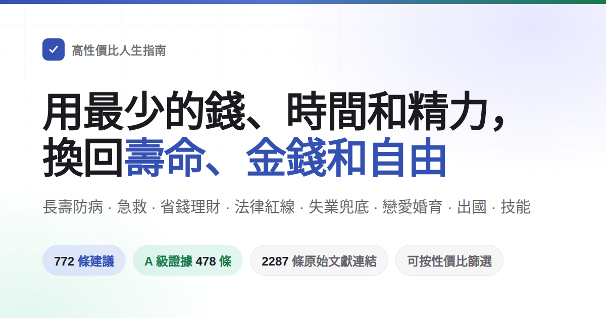

<div align="center">



# 高性價比人生指南

講怎麼活得久、怎麼少生病，出了意外怎麼救。講怎麼少花冤枉錢，哪些事會讓人被騙、攤上官司。講沒工作沒錢時能去領什麼，開店、開公司、做網站要辦什麼手續。也講戀愛結婚生孩子、出國和學手藝。法律、健保、勞保這些制度上的內容，本版已按台灣的現行規定改寫。<br>
772 條建議，每條寫明花掉什麼、換回什麼、證據有多硬，來源只引期刊論文和官方文件，少數官方不公開的案件引署名的原創新聞報導並附網頁存檔。

不用全做：這是一份備選單，不是任務清單——挑走一兩條就算數，作者自己也沒做到其中大部分。

書裡的內容可能過時，也可能有錯。不少政策各地執行不一樣。真去辦事、看病、打官司時，以當地部門、醫生和律師的說法為準。發現寫錯了，歡迎[提 issue](https://github.com/doggy8088/HowToLiveBetter/issues)。

這一版以台灣讀者為主，但全書尚未逐條核完。抽過的幾條，不能當成其餘條目都合格。還沒改完的位置和優先順序見 [台灣在地化待核](docs/台灣在地化待核.md)。上游原文在 [eternity4719/HowToLiveBetter](https://github.com/eternity4719/HowToLiveBetter)。正文若還看到大陸機構、大陸審限，或叫人打 120、12356，那是還沒改完的上游寫法，不能直接當成台灣的作法。文中的 QQ 群是上游留下的聯絡方式，不是台灣的求助專線。

在台灣，火災和急救打 119，報案打 110。情緒困擾或自殺念頭、人還安全時，打 1925 安心專線。人已經受傷、沒有正常呼吸，或危險正在發生，打 119。要警察到場就再打 110。不要只打 1925。這三支電話的官方頁，2026-11-07 查閱。查閱日不是法規公布日。

**電子書平台上的官方版本由果麥文化獨家出品**，2026 年 10 月上架，其他版本都不是官方的。那是上游商業版的說明。本倉庫的免費檔案不是台灣官方認證。本頁的網頁版、EPUB、PDF 照舊免費，更新也最快。

[](https://how-to-live-better.gh.miniasp.com/)
[](#目錄)
[](#證據分級)
[](docs/核實記錄/)
[](#授權聲明)
[](https://claude.com/claude-code)

### [打開線上檢索頁](https://how-to-live-better.gh.miniasp.com/) · [讓 AI 照書回答（skill）](skills/life-decision-guide/README.md)

AI 助手 skill 支援 Claude Code 和 Codex。裝上後直接問「替朋友擔保籤不籤」，它先查書裡的條目再回答，並註明出自第幾節第幾條。

<table>
<tr><td align="right"><b>下載</b></td><td align="left">

[PDF](https://github.com/doggy8088/HowToLiveBetter/releases/download/epub-latest/HowToLiveBetter.pdf) · [EPUB](https://github.com/doggy8088/HowToLiveBetter/releases/download/epub-latest/HowToLiveBetter.epub) · [離線單文件（HTML）](https://github.com/doggy8088/HowToLiveBetter/releases/download/epub-latest/HowToLiveBetter.html) · [Anki 牌組](https://github.com/doggy8088/HowToLiveBetter/releases/download/epub-latest/HowToLiveBetter.apkg)

</td></tr>
<tr><td align="right"><b>查閱</b></td><td align="left">

[目錄](#目錄) · [術語表](#讀懂數字術語表) · [核實記錄](docs/核實記錄/)

</td></tr>
<tr><td align="right"><b>自查</b></td><td align="left">

[生活自查](https://how-to-live-better.gh.miniasp.com/selfcheck.html)：回答幾十道是否題，看看書裡哪些事你還沒做到、先做哪幾件

</td></tr>
<tr><td align="right"><b>長文</b></td><td align="left">

[結婚划不划算](docs/結婚划不划算.md) · [家庭應急裝備清單](docs/家庭應急裝備清單.md) · [遇到陌生人出事該不該停](docs/遇到陌生人出事該不該停.md) · [做平台要辦哪些證](docs/做平台要辦哪些證.md) · [生物鐘和夜班](docs/生物鐘和夜班.md) · [被裁了之後先做什麼](docs/被裁了之後先做什麼.md) · [孩子出生前後要辦的事](docs/孩子出生前後要辦的事.md) · [剛確診慢性病之後](docs/剛確診慢性病之後.md) · [換工作、換城市之前](docs/換工作、換城市之前.md)

</td></tr>
<tr><td align="right"><b>交流</b></td><td align="left">

[QQ 群 582670354](https://qm.qq.com/q/P1RNw3Rnqg)（點選加群）

</td></tr>
<tr><td align="right"><b>其他語言</b></td><td align="left">

[English](其他語言.md) · [Русский](其他語言.md) · [Español](其他語言.md) · [Português](其他語言.md) · [العربية](其他語言.md) · [Bahasa Indonesia](其他語言.md) · [Tiếng Việt](其他語言.md)

讀者翻譯的版本，各版本的網站和維護者見[其他語言](其他語言.md)

</td></tr>
<tr><td align="right"><b>衍生工具</b></td><td align="left">

讀者做的網站、App、小程序、瀏覽器外掛和資料集，見[衍生項目](衍生項目.md)

</td></tr>
</table>

<sub>其他語言和衍生工具由他人維護，內容可能落後，以本倉庫中文原文為準。</sub>

</div>

---

## 這本書想回答的問題

| 問題 | 去哪看 |
| --- | --- |
| 幾乎不花錢，就能明顯降低早死機率的事有哪些？ | [1. 不要早死](book/01-不要早死.md) |
| 抽菸、喝酒、久坐、熬夜到底折壽多少，煙和酒具體怎麼戒，家常食用油怎麼選怎麼用？ | [2. 不要慢慢死](book/02-不要慢慢死.md) |
| 每天精力不夠用、總被打斷，怎麼改？ | [3. 不要浪費精力](book/03-不要浪費精力.md) |
| 時間都花哪去了，怎麼少做無收益的事，拖延怎麼治？ | [4. 不要浪費時間](book/04-不要浪費時間.md) |
| 攢下的錢該怎麼放，才不被利息、費率和騙局吃掉，買車怎麼不被坑？ | [5. 不要浪費錢](book/05-不要浪費錢.md) |
| 哪些保健品、健檢套餐、智商稅可以直接不買？ | [6. 反面清單](book/06-反面清單.md) |
| 失業了、被欠薪了、身上沒錢了，能領什麼、去哪求助？ | [7. 沒錢的時候怎麼活](book/07-沒錢的時候怎麼活.md) |
| 彩禮、婚前房產、戀愛期間的大額轉帳算誰的，被人報案指控或捏造事實舉報時第一步做什麼，自己惹了事主動去說能減多少刑，事後能不能追究和索賠？ | [8. 法律與財產安全](book/08-別把自己搭進去.md) |
| 哪些「兼職」和順手的小事會讓普通人變成刑事被告？ | [9. 普通人容易踩的法律紅線](book/09-普通人容易踩的法律紅線.md) |
| 追人該廣撒網還是死磕一個，異地戀能不能成，領證要帶什麼，只擺酒不領證算不算夫妻？ | [10. 戀愛和結婚划不划算](book/10-戀愛和結婚划不划算.md) |
| 寫哪些程式碼、接哪些單會被判刑？ | [11. 程式設計師和技術人容易踩的紅線](book/11-程式設計師和技術人容易踩的紅線.md) |
| 借錢開店、開公司之前最該先想清楚什麼？ | [12. 創業與做生意](book/12-創業與做生意.md) |
| 有人倒地沒了呼吸、大出血、火災、迷路，先做什麼？ | [13. 緊急情況：先做什麼](book/13-緊急情況.md) |
| 帳號被盜、手機丟了，第一步做什麼？ | [14. 帳號與資訊安全](book/14-帳號與資訊安全.md) |
| 押金被扣、房東趕人、長租公寓暴雷怎麼辦，買期房錢該打到哪、交房晚了怎麼辦、房貸利率能不能往下談，想搬去鄉下住能不能買農村的房？ | [15. 租房與買房](book/15-租房與買房.md) |
| 確診慢性病之後，長期該怎麼管、怎麼少花錢？ | [16. 得了慢性病之後怎麼活](book/16-得了慢性病之後怎麼活.md) |
| 老人的監護、遺囑和錢該怎麼提前安排？ | [17. 家裡有老人](book/17-家裡有老人.md) |
| 生孩子能領什麼、要佔掉多少時間和錢？ | [18. 養孩子划不划算](book/18-養孩子划不划算.md) |
| 加班費、年休假該怎麼算，被裁該拿多少補償，上班受了傷怎麼認定和拿錢？ | [19. 在職、離職和工傷](book/19-在職離職和工傷.md) |
| 孩子剛出生，最要緊的幾件事是什麼？ | [20. 剛出生的孩子怎麼帶](book/20-剛出生的孩子怎麼帶.md) |
| 哪些國家現在別去，出事了使領館管到哪一步？ | [21. 出國、旅行與境外安全](book/21-出國旅行與境外安全.md) |
| 去 KTV、網吧、密室怎麼不踩坑，壓力大時做什麼最有用？ | [22. 怎麼放鬆：娛樂場所和減壓](book/22-怎麼放鬆.md) |
| 學電焊、學英語、考證，哪些真的回本，怎麼學才省時間，職稱從哪裡報、值不值，要不要接著讀碩士、博士？ | [23. 學什麼技能划算](book/23-學什麼技能划算.md) |
| 同一個病在社區看和在三級醫院看差多少錢，傷得很重時是掛號排隊還是找急診分診台，治完要不要做傷殘鑑定、辦殘疾人證，種一顆牙該花多少錢、醫保報不報？ | [24. 看病：怎麼少花錢少走彎路](book/24-看病.md) |
| 家裡人走了，當時先做什麼、哪些錢能取回來、哪些費用可以不交？ | [25. 人走了以後要辦什麼](book/25-人走了以後要辦什麼.md) |
| 做個網站或平台收錢，要辦哪些證、伺服器放哪？ | [26. 做一個網站或平台](book/26-做一個網站或平台.md) |
| 懷孕了、要生了，什麼時候做什麼，出院前要辦哪些證？ | [27. 懷孕和生產](book/27-懷孕和生產.md) |
| 想減肥、想變好看、想矯正牙齒，哪些做法會把身體搞壞？ | [28. 別為了外形把身體搞壞](book/28-別為了外形把身體搞壞.md) |
| 親人走了、被裁了、拿到重病診斷，頭幾個月最要緊的是什麼？ | [29. 遭遇重大打擊之後](book/29-遭遇重大打擊之後.md) |
| 孩子上學以後，哪些身體和心理的事不能等到考完再說？ | [30. 上學以後的孩子](book/30-上學以後的孩子.md) |
| 十八歲之後除了讀書和打工還有哪幾條路，各自的門檻是什麼？ | [31. 十八歲之後有哪幾條路](book/31-十八歲之後有哪幾條路.md) |
| 出國留學，簽證身分怎麼才算沒斷，回國這張文憑認不認？ | [32. 出國留學：身分、打工、保險和回國認證](book/32-出國留學.md) |
| 自己或者家人殘疾了，先防住哪些併發症，能申請哪些補貼，上學就業和監護怎麼辦？ | [33. 殘疾之後怎麼活](book/33-殘疾之後怎麼活.md) |
| 感冒藥、退燒藥、胃藥自己買來吃，哪些不能一起吃，孩子、孕婦和老人要避開哪些？ | [34. 家裡的常備藥別吃出事](book/34-家裡的常備藥別吃出事.md) |

## 怎麼讀

- **不用全做**：這是一份備選單，不是任務清單。挑走一兩條就算數，剩下的放著，需要時再回來查。「說著容易做著難」這個評價是對的——作者自己也沒做到其中大部分，寫下來是為了要用的時候找得到。想挑省力的，看下面「只想看最值得做的」那條。
- **想讓 AI 幫你查**：倉庫裡帶了一個中文 skill（[skills/life-decision-guide](skills/life-decision-guide/)），Claude Code 和 Codex 都能裝。裝上以後直接問「替朋友擔保籤不籤」「每天通勤兩小時值不值」。它會先把相關條目從正文裡查出來，再照書裡的算帳方式排序回答，並註明出自第幾節第幾條。查不到就說查不到，不自己編數字。裝法見 [那個目錄的說明](skills/life-decision-guide/README.md)。
- **想按條件挑**：打開[線上檢索頁](https://how-to-live-better.gh.miniasp.com/)，可以按關鍵詞、章節、證據等級來篩，也可以按「花不花錢、花多少時間、要不要毅力」這三樣篩，幾個條件能疊著用。頁面上的內容直接取自 book/ 目錄裡的正文，正文一改，頁面跟著改。
- **條目之間會互相指路**（「見第 8 節第 17 條」這種）：在檢索頁裡，這種指路帶一條虛線。點一下，就地顯示被指的那條的標題和「說人話」。想真的翻過去，再按「跳過去」。那一條正好被篩選條件藏起來了，頁面會自動把篩選清掉。在 GitHub 上直接讀正文點不動，但每處指路後面都寫著指向什麼（「見第 18 條（借錢寫清借條）」）。不翻過去也知道說的是哪條。
- **想按順序讀**：每節內的先後順序不代表性價比高低。條目多的節開頭有一段分組導覽，按主題挑著看就行。
- **想離線看、想發給別人**：下載 [離線單文件 HTML](https://github.com/doggy8088/HowToLiveBetter/releases/download/epub-latest/HowToLiveBetter.html)，整本書連同檢索和篩選都在這一個文件裡，雙擊就開，不用伺服器也不用聯網，微信裡也能直接傳。
- **想列印或在手機上翻**：下載 [PDF](https://github.com/doggy8088/HowToLiveBetter/releases/download/epub-latest/HowToLiveBetter.pdf)，A4 排版、兩百多頁，帶目錄頁碼和書籤，每節另起一頁。
- **想在 Kindle 或其他閱讀器上讀**：下載 [EPUB 電子書](https://github.com/doggy8088/HowToLiveBetter/releases/download/epub-latest/HowToLiveBetter.epub)，Kindle 用 Send to Kindle 發過去即可。
- **想記住、隔幾天複習一遍**：下載 [Anki 牌組](https://github.com/doggy8088/HowToLiveBetter/releases/download/epub-latest/HowToLiveBetter.apkg)，用 Anki 打開就匯入。一條一張卡，按節分成子牌組。正面是建議，背面是說人話、成本和證據等級。可以只學其中幾節，也可以按「性價比極高」這類標籤篩。以後重新下載再匯入一次，卡片內容會更新，複習記錄不丟。
- **這四樣都是正文每次更新後自動重新生成的**，下載連結固定不變；轉發出去的那一份不會跟著更新，以線上版為準。
- **看不懂那串數字**：每條都有一行「說人話」。它把「收益」欄裡那些研究裡的寫法，翻成「同期死亡的機率低約兩成」「拘留幾日、罰多少錢」這樣的日常說法。它只用「收益」欄已經寫到的內容，不添新數字。只看這一行就夠拿主意。「收益」欄裡原樣留著全部數字，想自己核對就看那一欄。
- **只想看結論最硬的**：在檢索頁裡勾選證據等級 A，只留下有具體數字、來自薈萃分析或大型試驗的 478 條。
- **只想看最值得做的**：勾選性價比「極高」，得到 119 條不花錢、用時少、不需要毅力，收益又落在最大一檔的條目。再疊加一個「換回什麼」，就是該口徑下的優先清單。
- **看到「不要」開頭的節標題不用緊張**：節標題說的是這一節想防住的事（不要早死、不要浪費時間），不是說底下每條都在讓你別幹什麼。真正要做的動作寫在條目標題裡，一律動詞開頭，自己就寫清了是「做什麼」還是「別做什麼」。同一節裡兩種都有：第 4 節既有「把『打算做』寫成『幾點、在哪、遇到什麼就做什麼』」，也有「不看電視和滾動新聞」。按條目標題讀，不用往節標題的語氣上套。

每條建議長這樣：

```markdown
### 5. 把家裡的食鹽換成低鈉鹽（鉀鹽）
- 成本：一袋比普通鹽貴幾元。買的時候順手換，不額外佔時間。口味幾乎不變。
- 說人話：得過中風或 60 歲以上有高血壓的人，把家裡的鹽換成低鈉鹽，五年內死亡的機率低約 12%，中風低約 14%。
- 收益：一項把人隨機分成兩組的試驗，在中國農村做的，20995 人，都是得過卒中的人或者 60 歲以上的高血壓病人，追蹤了 4.74 年。結果：用低鈉鹽的那組比用普通鹽的那組，死亡風險低約 12%（RR 0.88）。卒中低約 14%（RR 0.86）。主要心血管事件低約 13%（RR 0.87）。
- 證據等級：A
- 來源：Neal B 等 (2021). Effect of Salt Substitution on Cardiovascular Events and Death. NEJM. https://doi.org/10.1056/NEJMoa2105675
- 備註：爭議。試驗對象是高危老人，健康年輕人換鹽得到的好處要小得多。腎功能不全的人，或者正在吃保鉀類藥物的人，換鹽前先問醫生。
```

## 自己跑一份

多數人用不著部署：[線上檢索頁](https://how-to-live-better.gh.miniasp.com/)是現成的，要離線就下[離線單文件 HTML](https://github.com/doggy8088/HowToLiveBetter/releases/download/epub-latest/HowToLiveBetter.html)，雙擊就開。

真要在自己電腦或伺服器上跑：

```bash
git clone https://github.com/doggy8088/HowToLiveBetter.git
cd HowToLiveBetter
python -m http.server 8000
```

然後瀏覽器開 `http://localhost:8000/`。檢索頁是純靜態的，`README.md` 和 `book/` 就是它的資料，沒有後端、沒有資料庫、不用裝依賴；把整個目錄丟給任何靜態伺服器（Nginx、GitHub Pages、物件儲存）效果一樣。注意 `index.html` 必須經 http 打開，直接雙擊本地文件會空白——瀏覽器不許網頁讀本地文件，那種場景請用上面的離線單文件版。

想自己生成這四樣（平時用不著，Release 裡的就是自動生成的）。下面的命令都在倉庫根目錄（`HowToLiveBetter/`）執行：

```bash
npm --prefix tools/epub ci                 # 安裝 EPUB 依賴
npm --prefix tools/epub run build          # EPUB
node tools/offline/build.mjs               # 離線單文件 HTML
node tools/pdf/build.mjs                   # PDF，另需 pandoc ≥ 3.1 和 typst ≥ 0.13
node tools/anki/build.mjs                  # Anki 牌組，要 Node ≥ 22.13（用自帶的 node:sqlite）
```

產物都在 `dist/`。

## 四種資源

這本書想幫你多留住的不只是壽命，一共四樣東西：

- **壽命**：活得更久，少死於本來可以避免的事
- **時間與精力**：活著的時間不花在沒有回報的事上，每天的注意力和體力少被白白耗掉
- **金錢**：少花冤枉錢，把錢花在收益確定的地方
- **人身自由**：不因為不知道一條紅線，把自己送進拘留所或者看守所

每一條建議都回答兩個問題：要花掉什麼（錢/時間/精力/毅力），能換回什麼（總死亡率變化 / 特定死因下降 / 時間與精力節省 / 金錢節省 / 保障與人身自由）。每條的性價比檔由檢索頁按收益大小和三項成本算出來，想挑划算的就按它篩選。

**一條建議的好處落在誰身上，是分檔的。** 按「這份好處將來有多大可能回到你自己身上」從高到低：① **你自己**；② **配偶和直系親屬**（父母、子女、祖父母外祖父母、孫子女外孫子女）；③ **朋友、同事和其他親屬**——互惠關係，幫出去的將來可能回來；④ **陌生人**——最低一檔，但不是零：回報的機率小，而且你不瞭解對方性格，還有被訛、被反咬、被報復的一面。不同檔不合並計算，寫到第 ④ 檔時好處和風險一起寫。

急救那一節照這個讀：中國 38,227 例院外心臟驟停裡 79.2% 發生在家裡，學按壓首先是為了按在自家人身上；「看到有人溺水自己不下水」「撞見鬥毆別上手拉架」這類規則本身就是自保規則，防的是你從旁觀者變成第二個傷者。對陌生人要不要出手是你自己的權衡，條目會把免責條款、自保動作和風險面都寫清楚，不替你把它算成非做不可的理由。

死亡率的數字、時間精力的數字、金錢的數字和法律後果，各算各的，不互相折算。這四樣對應檢索頁上那四個「換回什麼」，彼此之間不比大小。

## 證據分級

每條建議都標註證據等級：

| 等級 | 含義 |
| --- | --- |
| A | 有具體數字可查，出處是多項研究合併起來的薈萃分析、追蹤很多人很多年的大型佇列，或者隨機分組的試驗（RCT），能說出降了多少（HR、RR、下降百分比） |
| B | 有研究支援，但說不出一個確切數字；或者只有小樣本、單獨一項研究撐著 |
| C | 作者自己的經驗，或者大家公認的做法，沒有直接的研究文獻 |

全書 772 條中 A 級 478 條、B 級 240 條、C 級 54 條，另有 90 條標註了爭議、57 處標註了 TODO 待核實。有爭議的 A/B 級條目會標註「爭議」並列出反方證據。所有來源只引原始文獻（期刊論文附 DOI 或 PubMed 連結，或 WHO/CDC/國家統計局等官方機構報告），不引二手轉述。官方不公開的案件，少數條目引了有記者署名的原創新聞報導，只用來說明「發生過這類事」，來源欄附網頁存檔，備註寫明「只有媒體報導」。不確定的數字標「待核實」。

A 級只說明「有具體數字、出處可核」，不說明這個數字一定是因果。A 級裡既有隨機分組的試驗，也有只追蹤記錄、不分組的研究，後者分不清是這件事起了作用，還是做這件事的人本來就更健康。哪一種看收益欄：寫著「隨機分成兩組」的是前者，寫著「只記錄、不分組」的是後者。法律和政策類條目的 A 級，指的是引到了法條或官方文件原文。

收益欄和說人話裡的百分比，多數是比沒做的人低幾成，不是每一百人裡少幾個。同樣低 12%，本來風險就高的老人少掉的死亡人數，遠多於本來風險就很低的年輕人。所以先看說人話裡寫的是哪些人，再看那個百分比。

## 性價比檔

證據等級只回答「這個數字可不可信」，不回答「這件事值不值得做」。所以每條還另外標了兩樣：收益量級（好處有多大）和口徑（換回的是哪一類東西）。檢索頁拿這兩樣加上三項成本，合出一個性價比檔：

| 維度 | 取值 | 怎麼定的 |
| --- | --- | --- |
| 口徑 | 換壽命 / 換錢 / 換時間精力 / 換人身自由 | 看這條主要換回的是什麼。**不同口徑之間不做比較**，「總死亡率降 12%」和「每年省 500 元」不在一把尺子上，沒法分高下 |
| 收益量級 | 大 / 中 / 小 | 儘量照著條目自己的「收益」欄，按事先定好的界線套，不憑感覺：換壽命看降了百分之幾（≥20% 為大，10% 及以上、不到 20% 為中，<10%、或者只量到中間指標而沒量到最終結果的為小）；換錢看金額（萬元級為大，數百到數千為中，幾十元為小）；換人身自由看後果（避免刑事責任為大，避免拘留或行政處罰為中，避免民事糾紛為小）；換時間精力看省下多少（每天省出小時級為大，每週小時級為中，只省一次的為小） |
| 性價比 | 極高 / 高 / 一般 | 好處大、三項成本都在最低檔 = 極高；好處大、成本不高，或者好處中等、三項成本都在最低檔 = 高；剩下的 = 一般 |

三項成本的最低檔是「不花錢、用時少、不需要毅力」。「用時少」指一次花幾分鐘以內，或順手就能做。

全書 772 條中性價比極高 119 條（16%）、高 336 條（44%）、一般 305 條（40%）。中間那檔條數多是有意的：底下的收益量級本來就只分大、中、小三級，再往細裡切就是裝出來的精確。

**這一檔是作者自己的判斷，不是證據**，按本書的標準它本身只算 C 級；它和證據等級是兩回事，誰也不影響誰。一條可以證據是 A 級、性價比卻只算一般（帶狀皰疹疫苗有 97.2% 效力的三期 RCT，但兩針三四千元、帶狀皰疹很少致命），也可以證據只有 C 級、性價比卻極高（手機設鎖屏密碼、SIM 卡設 PIN 碼）。「一般」不等於不該做——全書的條目都是建議做的，只是這一檔得你自己掂量那筆花銷值不值。

## 讀懂數字（術語表）

正文儘量用日常說法，但引用研究的時候免不了出現幾個統計名詞。看不懂就查這張表；線上檢索頁裡，把滑鼠停在帶虛線的詞上（手機上點一下）也會彈出解釋。

<details>
<summary>展開 41 條術語（總死亡率、HR、RR、95% CI、薈萃分析、BMI、LPR、定金與訂金……）</summary>

| 術語 | 意思 |
| --- | --- |
| 總死亡率 | 一段時間裡，一群人當中死掉的人佔多大比例，不管死於什麼原因。本書用它衡量「活得久不久」。研究原文裡叫全因死亡率，英文縮寫 ACM |
| HR | 瞬時風險比。比較的是隨訪過程中，仍未出事的人在當時出事的快慢。HR 0.87 表示這一風險低 13%，不等於一段時間內出事的機率低 13% |
| RR | 相對風險。兩組人在相同觀察期內出事的機率之比。RR 0.87 表示相對低 13%，不是每一百人少出事 13 個 |
| OR | 比值比。先分別算出兩組「出事的機率 ÷ 不出事的機率」，再比較這兩個比值。它不等於機率之比，只有結局很少見時才近似 RR，不能一律換算成機率高几成、低幾成 |
| IRR | 發病率之比。發病率是一段時間裡新得這個病的人佔多大比例，兩組相除，讀法同 RR |
| RaR | 發生次數之比。比的是事情發生了多少次（譬如摔了多少跤），不是多少人出事，讀法同 RR |
| 標準化死亡比 | 英文縮寫 SMR。這群人實際死了多少人，除以「同樣年齡的普通人本該死多少人」。5.86 就是死的人數是同齡人的 5.86 倍 |
| 風險差 | 兩組出事的機率相減，直接得出「每一千人裡多出幾個」。倍數只說翻了幾倍，風險差說的是實實在在多了多少人 |
| 95% CI | 95% 信賴區間。研究算出的數字總有誤差，這是真實情況很可能落在的範圍。倍數類別的數字，範圍跨過了 1；加減類別的數字，範圍跨過了 0，就說明兩組的差別可能只是碰巧，文中會寫「無統計學意義」 |
| RCT | 隨機對照試驗。用抽籤一樣的辦法把人分成兩組，一組做這件事，一組不做，過後比結果差多少。要證明「是這件事起了作用」，這種做法最有說服力 |
| 薈萃分析 | 把很多項研究的結果湊到一起重新算，得出一個總的數字。也叫 meta 分析 |
| 佇列 | 佇列研究。挑一大群人追蹤很多年，記錄誰出了事。能看出兩件事常一起出現，但不足以證明是前一件造成了後一件 |
| 觀察性 | 觀察性研究。研究者只在旁邊記錄，不安排誰做、誰不做。結果容易被別的因素帶偏（見本表的混雜、反向因果兩條），數字要打點折看 |
| 混雜 | 有第三個因素同時牽動著前因和後果，讓兩件事看起來像有因果。譬如愛吃菜的人往往也更愛運動，分不清是哪一樣在起作用 |
| 反向因果 | 因果的方向弄反了：看著像前一件引起後一件，其實是後一件引起前一件。不是睡得多讓人早死，而是病重的人睡得多 |
| d、g | 效應量，表示兩組的差距有多大。把差距換算成「相當於幾倍的常見波動幅度」：0.2 算小，0.5 中等，0.8 大 |
| r | 相關係數。兩件事跟著一起變的緊密程度，取值從 -1 到 1，0.1 算弱、0.3 中等、0.5 算強 |
| MET | 運動強度的單位。安靜坐著是 1 MET，快走約 3 到 4 MET。寫成 MET·h，就是強度乘以做了幾小時，表示一共動了多少 |
| GRADE | 國際上通用的一套打分辦法，給一項證據有多可靠評級，分高、中、低、極低四檔 |
| 意向篩檢分析 | 算效果時按「通知了誰去做篩檢」算，不按「誰真的去做了」算。被通知的人裡總有沒去的，所以這種演算法會把篩檢對真去做的人的好處算低 |
| 包年 | 統計一個人一共抽了多少煙的單位。每天抽幾包乘以抽了幾年，30 包年就是每天一包抽了 30 年 |
| BMI | 體重指數，看胖瘦常用的一個數：體重的公斤數，除以身高米數的平方 |
| LDL | 低密度脂蛋白膽固醇，俗稱壞膽固醇 |
| eGFR | 估算腎小球濾過率，衡量腎臟過濾能力的一項指標，單位 mL/min/1.73 m²。數越低說明腎功能越差，慢性腎病分幾期就按它定 |
| HBsAg | B 型肝炎表面抗原，檢驗單上的一項。結果是陽性，表示已經感染了 B 型肝炎病毒 |
| HPV | 人乳頭瘤病毒。它分很多型，其中一部分型長期感染會導致子宮頸癌 |
| LDCT | 低劑量胸部 CT，輻射量約為普通 CT 的五分之一到十分之一 |
| PM2.5 | 飄在空氣裡的細顆粒物，直徑在 2.5 微米以下 |
| NOVA | 一種給食品分類的辦法，按加工得有多厲害分成四類，「超加工食品」就是其中的第四類 |
| LPR | 大陸的貸款市場報價利率，那邊房貸利率照它算。台灣沒有這個基準：指數型房貸的利率是銀行指標利率加簽約時約定的加碼，書裡提到 LPR 都是在做兩岸對照 |
| 一裁終局 | 大陸勞動仲裁用語：仲裁判下來直接生效，單位不能再告。台灣沒有這套強制仲裁，勞資爭議先走勞工局調解，調解不成照樣能去法院 |
| 粗結婚率、粗離婚率 | 每一千人裡，當年登記結婚、登記離婚的對數。另外還有個數叫離結比，是當年離婚對數除以結婚對數，和這兩個不是一回事，別混著看 |
| AED | 自動體外除顫器。公共場所常見的紅色或黃色急救箱，開機以後跟著語音提示做就行，要不要電擊由它自己判斷 |
| CPR | 心肺復甦。心臟驟停時用力按壓胸口，讓血繼續流動 |
| 3C 認證 | 大陸強制性產品認證。台灣對應的是標準檢驗局的 BSMI 檢驗，買大件那條用的就是 BSMI 標識 |
| ICP 備案 | 大陸的網站登記。網站上線前向工信部登記。台灣沒有這套制度，一般網站不必先辦。見第 11 節和第 26 節 |
| 等級保護 | 大陸的網絡安全等級保護制度，按系統重要性分級。台灣沒有這套分級；接政府機關或關鍵基礎設施的案子時，資通安全管理法的要求會透過契約轉到你身上 |
| GPL | 一種開源許可證。用了這類程式碼做出來的東西，往外發的時候通常也得把自己的程式碼一起公開 |
| 競業限制 | 和公司籤的一種約定：離職後一段時間內不去同行的對手那裡上班。台灣要同時符合四個要件才有效：公司有正當營業利益、你的職務能接觸營業秘密、限制範圍合理、公司給合理補償。期間最長兩年，補償每月不能低於離職時月平均工資的一半 |
| 認繳出資 | 大陸公司法的說法：註冊時先承諾出資、到期才繳。台灣沒有先認後繳，有限公司的資本要全部繳足、經會計師查核才能設立登記，所以登記多少就得真的拿出多少 |
| 定金與訂金 | 兩個詞只差一個字，效力差很多：定金有罰則，付錢的一方反悔拿不回來，收錢的一方反悔要加倍返還（民法第二百四十九條）；台灣沒有大陸那種「最多合同額兩成」的上限，金額自己談。訂金不在民法裡，退不退全看約定 |
| 一審審限 | 台灣《民事訴訟法》沒有規定一審普通程序六個月、簡易程序三個月必須審完。那組月數是大陸民事訴訟法的審限。司法院《各級法院辦案期限實施要點》（民國 114 年 12 月 30 日修正）是法院內部列管，逾期要報，不是法定上限。自己請的律師，酬金通常自己付。敗訴的人負擔訴訟費用，見民事訴訟法第七十八條。法院依法選任的律師酬金，和第三審律師酬金，才算訴訟費用的一部分（第七十七條之二十五、第四百六十六條之三）。條文於 2026-11-07 查閱。[民事訴訟法](https://law.moj.gov.tw/LawClass/LawAll.aspx?pcode=B0010001)、[辦案期限實施要點](https://legal.judicial.gov.tw/FLAW/dat02.aspx?lsid=FL000872) |

</details>

## 目錄

1. [不要早死](book/01-不要早死.md)：外因死亡、瓦斯與中毒、疫苗、篩檢、心理危機與自殺念頭的時間尺度、被救回來之後留下什麼、墜落重傷之後的那一年、賣掉一個腎之後剩下那個腎的帳、家庭應急裝備、肉眼血尿等該去查的信號、65 歲以上女性查骨密度與查出骨質疏鬆就用藥、上野外冰面前先量冰厚、用角磨機裝好護罩戴護目鏡、直接問身邊人有沒有想過自殺、查出房顫吃抗凝藥、查一次 C 型肝炎抗體、下化糞池窨井之前先通風、檢測並落實防護監護、高風險的人做胃鏡篩檢、泡發的木耳別過夜、咳嗽兩週以上去查肺結核並把藥吃滿。口徑：總死亡率 或特定死因。
2. [不要慢慢死](book/02-不要慢慢死.md)：菸酒、運動、睡眠、飲食（低鈉鹽、堅果、全穀物、加工肉、散裝自榨花生油、植物油代替豬油）、久坐，以及戒菸戒酒的具體辦法（戒菸藥、戒菸日、戒菸門診與熱線、電子煙、酒精戒斷不能自己硬扛）、午睡時長、熬夜之後怎麼補、上夜班的年數帳、做飯開抽油煙機、停經前後潮熱去評估激素治療、養狗和壽命的帳、定期查血脂、查出糖尿病前期靠少吃多動往後推、發黴的花生玉米堅果整包扔、別吃淡水魚做的魚生。口徑：總死亡率 或特定死因。長文見 [docs/生物鐘和夜班.md](docs/生物鐘和夜班.md)。
3. [不要浪費精力](book/03-不要浪費精力.md)：睡眠、打斷、多任務、人際負債、和機構打交道時該有的預期、痛經別硬扛、長期失眠先做認知行為治療、打鼾憋氣去查睡眠呼吸暫停。口徑：精力/時間。
4. [不要浪費時間](book/04-不要浪費時間.md)：無收益項目、沉沒成本、拖延（情緒解釋、改環境、承諾裝置、習慣要多久、自助材料）、會議、通勤。口徑：時間。
5. [不要浪費錢](book/05-不要浪費錢.md)：自動續費、綜所稅申報先比扣除額、台灣沒有公積金看勞退自提和青安貸款、資費重算、彩票、借錢先換成年化利率、孩子儲值打賞可主張退費、學名藥、健保沒有家庭共濟、基金費率、勞退自提先算稅率、預付款先看履約保障、網購七日退貨、直播買的東西出事找平台和消保官、不安全食品的求償、大件先查 BSMI 和能效標示、手串名錶潮玩不按投資算、珠寶玉石認鑑定書、盲盒抽卡、海外資產走複委託或國內海外基金；中段講保險：只給扛不住的損失買、掙錢的人先買定期壽險、保單送達十天內可撤銷、櫃檯看清是存款還是保險、退保自己辦別找代辦、受益人寫具體的人、請求權時效兩年；然後是別買虛擬貨幣，境外平台不受台灣監理；沒單位的人自己保養老：有工作去職業工會保勞保、沒工作靠國民年金，年資先滿 15 年；節末講買車：新車 180 天或 12,000 公里內出重大瑕疵可換車解約、中古車被隱瞞事故泡水可解約加懲罰性賠償、保險和貸款不必在店裡辦、跟團被帶進沒約定的購物店回國一個月內找旅行社、理專推薦的商品先在官網查到再買。口徑：金錢。
6. [反面清單](book/06-反面清單.md)：看起來性價比高但其實不高的東西，含「意志力會用完」這個說法，靠學搬運姿勢防腰痛，骨折之後猛補鈣、喝骨頭湯，靠 AI 聊天機器人自己判斷病情和法律問題，以及「人隨時會死，早點把錢花完」這個說法、中老年膝蓋退化疼別做關節鏡清理、別靠褪黑激素治長期失眠、感冒別要求輸液。
7. [沒錢的時候怎麼活](book/07-沒錢的時候怎麼活.md)：救助、補貼、找活、住宿吃飯、醫療、欠薪維權、避坑、信用卡網貸還不上找銀行協商分期、別找停息掛帳中介。口徑：金錢/保障。
8. [別把自己搭進去：法律與財產安全](book/08-別把自己搭進去.md)：交通事故、被騙打 165 圈存止付、AI 換臉擬聲先掛斷用舊號碼回撥、自首能減刑與躲通緝為什麼不通、被指控先請律師、被人捏造事實檢舉怎麼追究誣告、衝突不先動手、報復念頭當急症處理與家屬的協助送醫、給家人投保後動手的四道法律門、被網暴先留證再從平台和法院挑路、聘金走轉帳備註、婚前財產、擔保、反詐、熟人讓你刷臉念驗證碼的 AB 貸、請求權時效、被強制執行與信用註記和限制出境各自有救濟、養犬登記與狂犬疫苗、報案拿受（處）理案件證明單、送錢辦事就是行賄、家暴打 110 和 113 再聲請保護令、防入室竊盜的門窗鎖與感應燈。口徑：金錢/人身自由。
9. [普通人容易踩的法律紅線](book/09-普通人容易踩的法律紅線.md)：謠言、汙辱國旗國徽、境外內容只看不轉、傳播色情、兼職洗錢、偽造材料騙貸、偽造事故騙理賠、高空拋物、模擬槍、無人機註冊與禁航區、偷拍、養不了孩子時的收出養媒合與買賣遺棄的界線、賭博、野味與保育類、賣器官與幫人找供體、嫖娼的罰則，第 24、25 條是著作權：漢化、搬運、分享雲端硬碟資源不收錢也侵權、掛廣告收會員費就可能判刑，寫同人拿去出版賣錢先拿許可，節末是為了防身帶甩棍、電擊器、匕首、辣椒水出門會被罰，以及電魚和禁漁期捕魚、上墳野炊在林區點火、不找人替考不買賣答案。口徑：人身自由/金錢。
10. [戀愛和結婚划不划算](book/10-戀愛和結婚划不划算.md)：擇偶策略、糾纏的紅線、興趣信號、關係品質、異地戀、登記流程、婚檢、健康帳、時間帳、錢帳、父母出資買房與夫妻共同債務、退出成本、關係卡住了一起去做伴侶治療、擺了酒席不領證不算夫妻、配偶拿共同的錢打賞主播或轉給婚外的人怎麼辦、離婚時寫清孩子的撫養費和探望。長文見 [docs/結婚划不划算.md](docs/結婚划不划算.md)。
11. [程式設計師和技術人容易踩的紅線](book/11-程式設計師和技術人容易踩的紅線.md)：外掛、爬蟲、搶票指令碼、刪庫、帶走原始碼、接單開發、競業、開源許可、備案、跳過或屏蔽別家廣告的工具、AI 中轉站、破解修補程式和序號產生器、DDoS 打流量。口徑：人身自由/金錢。
12. [創業與做生意：別把家底賠進去](book/12-創業與做生意.md)：本錢、擔保、主體選擇、註冊登記、許可證、納稅申報、發票、涉稅詐騙、合同、用人、量產、進貨與用圖的知識產權紅線、退場，節末兩條講代營運、開店培訓和「無貨源」這類先收小錢再層層加錢的創業騙局，以及每年上半年要報的年報、湊錢做生意別公開招人投錢、租鋪面先查能不能開店、合夥先寫書面協議。口徑：金錢/法律責任。
13. [緊急情況：先做什麼](book/13-緊急情況.md)：心臟驟停、卒中與後循環卒中、眼中風、心肌梗塞、主動脈夾層、霹靂樣頭痛、慢性硬膜下血腫、肺栓塞、大出血、咬傷、燒燙傷、過敏性休克、癲癇、低血糖、觸電、一氧化碳、誤服與化學品灼傷、扎進身體的異物、骨折固定、騙局、隱私威脅、中暑、火災、溺水、迷路、失溫、蛇咬、地震、野獸、雷擊、高原病、蜱蟲、野外飲水；還有救不救得起：老人摔倒怎麼扶、撞見鬥毆怎麼辦、救人受傷之後的錢找誰；節末是 1 歲以下嬰兒噎住、嬰兒心肺復甦、孩子吞紐扣電池和磁珠、照看喝醉的人、斷指怎麼保存、撞掉的恆牙怎麼放回、黑色柏油樣大便當天去急診。口徑：存活率與金錢，末幾條兼及人身自由。
14. [帳號與資訊安全](book/14-帳號與資訊安全.md)：二次驗證、密碼、SIM 卡、手機丟失、金融卡盜刷、登入設備、App 權限、人臉辨識、查閱與刪除權、來路不明的 AI 中轉站、每年查名下的電話卡和金融卡、換號前先改綁帳號。口徑：金錢/個人資訊。
15. [租房與買房](book/15-租房與買房.md)：押金寫進契約、逼遷斷水電先報警留證、租金付給房東本人、包租業者查許可和營業保證金、買賣不破租賃、簽約前核對權狀和抵押、成屋房款走履約保證或價金信託專戶、別租違法隔間、農地農舍的資格限制；買房：預售屋先看履約擔保是哪一種、認購定金先寫清貸款沒核准退不退、面積誤差怎麼找補和廣告留證、遲延交屋的遲延利息、預告登記卡位、指數型房貸省息靠轉貸或提前還款、自住先問青安貸款和利息補貼、管委會不能停水停電催管理費、交屋驗屋與保固期。口徑：金錢。
16. [得了慢性病之後怎麼活](book/16-得了慢性病之後怎麼活.md)：服藥依從、重大傷病證明、複查記錄、別停藥試偏方、慢性病連續處方箋、家醫計畫、併發症篩檢、腎結石復發預防、痛風的達標治療與防發作、B 型肝炎帶原者每半年查超音波和甲胎蛋白、慢阻肺的吸入劑和肺復健、有高血壓糖尿病的每年查腎、結腸癌術後有人指導的運動。口徑：總死亡率/金錢。長文見 [docs/剛確診慢性病之後.md](docs/剛確診慢性病之後.md)。
17. [家裡有老人](book/17-家裡有老人.md)：意定監護、遺囑形式、帳戶與話術、投資養老與以房養老騙局、長期護理保險、長期臥床的壓瘡防護、白內障影響看路就去評估手術、老人遛狗別被拽倒、送養老院先查備案與押金上限、子女護理假、記性變差去記憶門診。口徑：金錢/人身自由，壓瘡、白內障和遛狗三條為死亡率。
18. [養孩子划不划算](book/18-養孩子划不划算.md)：生育給付和政府補助、育兒津貼、產假陪產檢及陪產假、育嬰留職停薪和八成薪津貼、不得因懷孕生育降工資辭退、時間帳、錢帳、為誰生各記一筆帳、晚幾年再生的年齡帳。口徑：金錢/時間。
19. [在職、離職和工傷](book/19-在職離職和工傷.md)：加班費三種演算法、特別休假、試用期不是法外之地；職業病危害告知與體檢、粉塵噪聲防護和停工退避；資遣費新舊制、預告期間工資、違法解除可要求回職、別籤主動辭職、留證；職災給付與核定、僱主沒保照領、失能給付、職災死亡兩邊領；長期被欺負留證據；服務證明書、資遣費定額免稅；換工作勞保年資自動併計、勞退專戶跟著走、沒書面契約先留證、沒加保低報可離職拿資遣費、離職違約金對照兩個法定框架、調動五原則要書面留紀錄、派遣先分清誰是僱主、不簽空白契約。口徑：金錢。長文見 [docs/被裁了之後先做什麼.md](docs/被裁了之後先做什麼.md) 和 [docs/換工作、換城市之前.md](docs/換工作、換城市之前.md)。
20. [剛出生的孩子怎麼帶](book/20-剛出生的孩子怎麼帶.md)：安全睡眠、B 型肝炎首針、照時程打齊公費疫苗、母乳與輔食、衝奶水溫、蜂蜜、維生素 K、發熱就醫紅線、不搖晃、尿布與大件採購、高危孩子早引入花生防過敏、新生兒黃疸的就醫信號、媽媽吃素時補維生素 B12、別買帶輪子的學步車、嬰兒每天補維生素 D、洗澡先放冷水防燙。口徑：嬰兒死亡率/金錢。
21. [出國、旅行與境外安全](book/21-出國旅行與境外安全.md)：安全提醒級別、外交部緊急聯絡中心 0800-085-095、領事保護的邊界、境外醫療保險、境外高薪招聘騙局、境外取現的年度額度、證件丟失、境外駕照、中介備案、出國帶藥先查目的地規定、回國別帶肉製品和水果。口徑：金錢/人身自由。
22. [怎麼放鬆：娛樂場所和減壓](book/22-怎麼放鬆.md)：安全出口、明碼標價、涉毒紅線、別人遞的東西、劇本殺選址；運動、正念、呼吸、社交、綠地、喝了酒別泡溫泉蒸桑拿、滑雪騎車戴安全帽、50 歲以後培養一個愛好。口徑：金錢/人身自由，以及精力/總死亡率。
23. [學什麼技能划算](book/23-學什麼技能划算.md)：讀書還是打工（童工年齡線、教育與死亡率、全國學歷結構、高中職免學費與就學貸款、技高五專的路、怎麼自己算這筆帳）、教育回報率、先查是不是勞動部技術士證、政府補貼的培訓管道、哪些本事不容易被機器取代、技能等級能不能換錢、缺工資訊怎麼查，以及定下來學什麼之後怎麼學（自測、分散練習、別靠劃重點、交錯練習、學習風格沒有證據），再來是台灣沒有職稱評定（要的是專技考試或公司職級、代辦買證的後果、拿到證不等於漲工資），以及要不要接著讀碩士、博士（學費和少採的工資、扣掉個人差別後的收入回報、博士生的憂鬱焦慮比例）。口徑：金錢/時間，其中一條為死亡率。
24. [看病：怎麼少花錢少走彎路](book/24-看病.md)：診所先看再轉診、沒有起付線只有固定部分負擔、轉診單走轉診櫃檯別找黃牛、全國健保特約院所都能看、國外緊急就醫回國核退有上限、病歷影像自己留存、急診五級檢傷、沒錢沒證件急診也得先救、失能與後遺障礙的鑑定時機、身心障礙證明怎麼辦、不用給醫生紅包、植牙先問總價對收費標準、健保藥缺貨拿處方箋去特約藥局、通訊診療複診、住院費用清單逐項對。口徑：金錢/時間。
25. [人走了以後要辦什麼](book/25-人走了以後要辦什麼.md)：先分病死非病死再報警、死亡證明書怎麼開、遺體接運與火化許可、死因異議與相驗、三十日內辦死亡登記、殯葬收費對基準表簽書面契約、亂收費打 1950、禮儀公司查許可、勞保勞退國民年金逐個領、死者的帳號和個人資料、欠債只在遺產範圍內還與三個月拋棄繼承、繼承不用公證先申報遺產稅。口徑：金錢。
26. [做一個網站或平台：資質、備案和伺服器](book/26-做一個網站或平台.md)：支付結算紅線、台灣不用 ICP 備案、直播與視聽的台灣口徑、平台核驗與涉稅報送、內容治理、實名、未成年人、通知刪除、資料出境、伺服器選型、使用者資訊洩露後通知、自動續費的提醒義務。口徑：人身自由/金錢。長文見 [docs/做平台要辦哪些證.md](docs/做平台要辦哪些證.md)。
27. [懷孕和生產：從發現懷孕到出院辦證](book/27-懷孕和生產.md)：葉酸、孕媽咪健康手冊與十四次補助產檢、三病篩檢與母嬰阻斷、孕期菸酒、阿斯匹靈與妊娠期糖尿病篩檢、立刻去醫院的信號、破水處置、無痛分娩、沒指徵別要求剖宮產、勞保國保生育給付、出生證明書、新生兒足跟血與聽力篩檢、健保加保與出生登記、產後兩次補助健康照護、懷孕了貓不用送走、孕期打流感滅活疫苗、孕晚期側著睡（爭議）、產後避孕與生育間隔（爭議）。口徑：死亡率與金錢。長文見 [docs/孩子出生前後要辦的事.md](docs/孩子出生前後要辦的事.md)。
28. [別為了外形把身體搞壞](book/28-別為了外形把身體搞壞.md)：極端節食與進食障礙、醫美先查合法醫療機構和醫師資格、面部填充的失明部位、承諾「快速瘦」的減肥產品、合成代謝類固醇、減肥藥減重針和性激素要處方和複查、體像評估、矯正牙齒要牙醫師當面檢查和複診、美白霜先上食藥署登錄平台查。口徑：死亡率（健康終點），醫美兩條兼及人身自由。
29. [遭遇重大打擊之後](book/29-遭遇重大打擊之後.md)：喪親頭一個月的心血管窗口、重病診斷的第一週、失業、喪偶後的半年、因自殺喪親、沒有親人也沒有朋友時怎麼替代那個人、家長去世的孩子、哀傷卡住了去哪掛號、離婚、1925 安心專線、別在應激期做不可逆的決定、用死還債這條路不通、自己經歷創傷後的心理治療與別做一次性晤談。口徑：總死亡率，談花錢與待遇的四條為金錢。
30. [上學以後的孩子](book/30-上學以後的孩子.md)：按小時算的急症、別為了考試推遲治療、被欺凌怎麼辦、每天戶外 2 小時、學生體檢報告單、青少年憂鬱篩檢、治癒近視的產品、睡眠作業沒有全國統一明文、國中小是義務教育沒有休學、散瞳驗光與複查、窩溝封閉、管孩子不打不吼罵、家長課、別送戒網癮學校、教孩子認識隱私部位防性侵、騎車上路的年齡門檻、運動撞頭當天別再上場。口徑：死亡率與健康終點，另有金錢和時間各一到兩條。
31. [十八歲之後有哪幾條路](book/31-十八歲之後有哪幾條路.md)：各條路的法定門檻；當兵（徵兵四步驟、役期看出生年次、妨害兵役是刑事罪、大學生當兵沒有學費補償、退輔會的就學就業服務、志願役簽幾年）；公務人員考試分等級、台灣沒有服務換考錄的基層項目；偏鄉教書公費生分發六年；消防員走警察特考；空中大學補學歷；師資公費、醫學公費、警專公費各自的履約年限；出國打工查仲介的就業服務許可；在家給境外公司幹活自己報稅；青年創業貸款；不進單位去職業工會加保；外送專法的基本報酬下限；台灣考公沒有應屆生這道門。口徑：金錢/時間，妨害兵役那條兼及人身自由。
32. [出國留學：身分、打工、保險和回國認證](book/32-出國留學.md)：交學費前查教育部外國大學校院參考名冊；美國 F-1「最長四年、讀完 30 天內走」的新規被法院暫停，眼下仍是讀完為止；美加英澳四國的打工時數上限；按國家、工作型別和在讀狀態核對打工資格；搬家按各國期限通報地址；外交部旅遊警示和教育部留學安全提醒；澳大利亞 OSHC 不能斷；英國醫療附加費；回國的驗證與採認沒有單一機構、先留時間；不能採認的八種情形和代辦「包認證」的坑、美國 OPT 失業天數上限、加拿大省級證明信。口徑：金錢/人身自由。
33. [殘疾之後怎麼活](book/33-殘疾之後怎麼活.md)：自主神經反射異常的現場三步、致殘後十年的自殺窗口、精神障礙住院自願原則與法院裁定、照護者自己的死亡風險、輪椅減壓坐墊、治癒系騙局、身心障礙證明下來後該問全的補助、未滿六歲的早期療育、長照無障礙改造額度、僱用身心障礙者的法定名額、身心障礙特別扣除額、導盲犬與大眾運輸半價、大學入學考試的合理便利、學校不得拒收與在家教育、下肢失能考駕照、復健機構怎麼挑、助聽器、監護與輔助宣告、被拒招減薪的申訴、脊髓損傷後別長期插著尿管。口徑：死亡率/金錢/時間/人身自由。
34. [家裡的常備藥別吃出事](book/34-家裡的常備藥別吃出事.md)：對乙酰氨基酚別吃重複、孩子退燒不用阿斯匹靈尼美舒利安乃近、布洛芬傷胃的高危人群、2 歲以下不自己餵複方感冒藥、懷孕 20 週後不自己吃布洛芬、奧美拉唑自己吃最多 7 天、感冒不要抗生素、腹瀉先補液與孩子不給止瀉藥、止痛藥吃多了反而頭痛、過期藥和剩藥投有害垃圾、頭孢甲硝唑期間和停藥後 7 天不喝酒、吃了犯困的感冒藥抗過敏藥別開車、吃降脂藥降壓藥的看說明書別吃西柚和柚子、腎不好的人別自己長期吃布洛芬這類止痛藥也別吃楊桃。口徑：死亡率。

「不要早死」「不要浪費時間」這類節標題說的是這一節想防住的結果，條目本身要做還是別做，以條目標題為準。長文另見 [docs/家庭應急裝備清單.md](docs/家庭應急裝備清單.md)、[docs/做平台要辦哪些證.md](docs/做平台要辦哪些證.md)、[docs/結婚划不划算.md](docs/結婚划不划算.md) 、[docs/遇到陌生人出事該不該停.md](docs/遇到陌生人出事該不該停.md)、[docs/生物鐘和夜班.md](docs/生物鐘和夜班.md)，以及四份按時間排的場景清單：[docs/被裁了之後先做什麼.md](docs/被裁了之後先做什麼.md)、[docs/孩子出生前後要辦的事.md](docs/孩子出生前後要辦的事.md)、[docs/剛確診慢性病之後.md](docs/剛確診慢性病之後.md) 和 [docs/換工作、換城市之前.md](docs/換工作、換城市之前.md)。每條來源的核實過程記錄在 [docs/核實記錄](docs/核實記錄/)。

本書在 Claude Code 協助下編寫：查找原始文獻、逐條核對數字與原文是否一致、維護交叉引用和建構指令碼。選題、取捨和最終審定由作者負責，每條數字都能在來源欄的原文裡找到。

倉庫根目錄的 `index.html` 是線上檢索頁：按關鍵詞、章節、證據等級和成本維度（花錢、花時間、要毅力）篩選條目，資料直接讀本文件。在倉庫設定裡開啟 GitHub Pages（Deploy from a branch，分支 main，目錄 /）後即可訪問。`tools/epub/` 是電子書生成指令碼，在倉庫根目錄跑 `npm --prefix tools/epub ci && npm --prefix tools/epub run build` 在本地出一本 EPUB 到 `dist/`；GitHub Actions 在正文改動後自動跑同一個指令碼並更新 Release。

## 正文

正文按節拆成 34 個文件放在 [book/](book/)，點上面目錄裡的節名進入。拆開是因為單文件已經超過 GitHub 渲染 Markdown 的 512 KB 上限，後面的節顯示不出來；[線上檢索頁](https://how-to-live-better.gh.miniasp.com/)會把這些文件合起來讀，用法不變。

## 授權聲明

正文用 [CC BY 4.0](LICENSE) 發布，範圍是 book/、docs/ 和本 README 的文字。你可以轉載、改編、商用，不用來問作者，但要做到三件事：

- 寫明出處：「高性價比人生指南」，附上倉庫連結 https://github.com/eternity4719/HowToLiveBetter 。
- 附上許可證連結 https://creativecommons.org/licenses/by/4.0/ 。
- 改過內容的要寫明改過。書裡的法條、補貼標準和截止日期經常更新，建議同時寫上你同步的是哪一天的版本。

程式碼用 [MIT](LICENSE-CODE)，範圍是 tools/、skills/、index.html 和 .github/。著作權標示是 Copyright (c) 2026 eternity4719。改程式時保留這段宣告。CC BY 4.0 不管這一部分，MIT 也不把正文變成可以不署名就轉載。

## Star 走勢

[](https://star-history.com/#doggy8088/HowToLiveBetter&Date)
